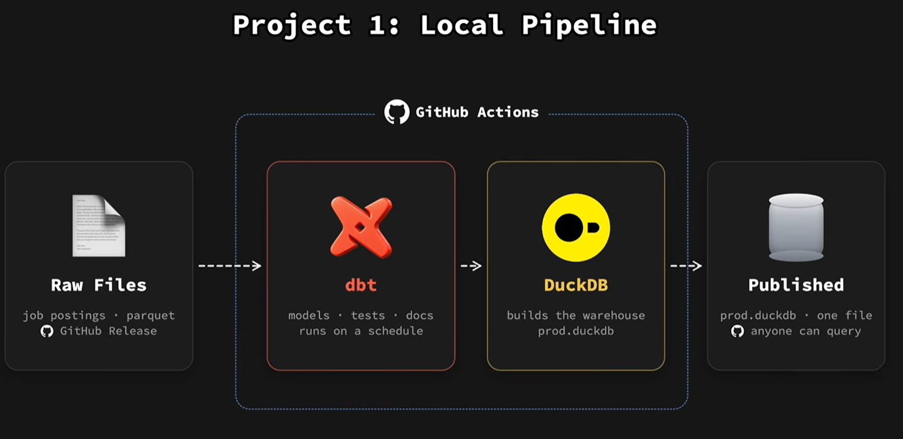

# Automated Job Postings Pipeline (v1): dbt + DuckDB

**🌐 Live dbt docs:** [joanasoares0.github.io/dbt-duckdb-pipeline](https://joanasoares0.github.io/dbt-duckdb-pipeline/)



An end-to-end analytics engineering pipeline built on **12 months of job postings** (Jul 2025 – Jun 2026). Raw parquet files are modeled with **dbt**, built into a **DuckDB** warehouse, and published as a single `prod.duckdb` file that anyone can query. **GitHub Actions** rebuilds it on every push to `main` and once a week.

> 🚀 **Coming next: v2 on Databricks.** This is the free, local-first version. A more advanced v2 is planned on **Databricks**, with cloud storage, a lakehouse architecture and production-grade orchestration.

---

## ✨ Highlights

- **Raw data, no infrastructure:** dbt reads monthly parquet files directly through DuckDB's `read_parquet`, declared as a dbt **source**. No database server or loading step.
- **Layered dbt models:** a cleaned staging view (`job_postings`) feeds three insight marts (`jobs_per_month`, `monthly_summary`, `top_locations`).
- **Data quality built in:** `not_null` and `unique` tests on each mart's grain, plus a `not_null` test on the staging model that catches scraper error rows.
- **Documented models:** every model and column has a description, persisted to the warehouse with `persist_docs`.
- **CI/CD with GitHub Actions:** `uv sync`, then download the data, then `dbt build`, then publish. Runs on push, every Monday at 06:17 UTC, and on demand.
- **A published warehouse:** the build uploads `prod.duckdb` to a GitHub Release, so anyone can query the results without cloning the repo.
- **Separate environments:** local development uses your own dbt profile, and CI builds the `prod` target from [`ci/profiles.yml`](ci/profiles.yml).

---

## 🏗️ Architecture

| Stage | Tool | What happens |
|---|---|---|
| **Raw files** | GitHub Release | 12 monthly `raw_job_postings_*.parquet` files plus `raw_job_skills.parquet` |
| **Transform** | dbt | Sources → staging → marts, with tests and docs |
| **Warehouse** | DuckDB | Everything builds into a single file, `prod.duckdb` |
| **Publish** | GitHub Actions | `prod.duckdb` is uploaded to the `warehouse` release |

### dbt lineage

```
source: raw.job_postings  (read_parquet ../data/raw/raw_job_postings_*.parquet)
   └── job_postings        (view: cleaned, error rows removed)
         ├── jobs_per_month    (table: postings per month × role)
         │     └── monthly_summary  (table: monthly totals + % remote)
         ├── monthly_summary
         └── top_locations     (table: top 10 locations)
```

📖 **[Browse the dbt docs](https://joanasoares0.github.io/dbt-duckdb-pipeline/)** to see the lineage graph, model and column descriptions, and tests. They're hosted on GitHub Pages. You'll find more detail on the models in [`analytics/README.md`](analytics/README.md).

---

## 🔍 Query the published warehouse

You don't need to clone anything. Open DuckDB and attach the release asset:

```sql
INSTALL httpfs; LOAD httpfs;
ATTACH 'https://github.com/joanasoares0/dbt-duckdb-pipeline/releases/download/warehouse/prod.duckdb' AS jobs (READ_ONLY);

SELECT * FROM jobs.main.monthly_summary;
SELECT * FROM jobs.main.top_locations;
```

---

## 💻 Run it locally

```bash
# 1. Install dependencies (Python ≥ 3.11, managed with uv)
uv sync

# 2. Download the raw data (~85MB) into data/raw/. Run this from the repo root.
uv run python scripts/download_data.py

# 3. Build models and run tests
cd analytics
uv run dbt deps
uv run dbt build

# 4. (optional) Browse the docs and lineage graph
uv run dbt docs generate
uv run dbt docs serve
```

> A local build needs an `analytics` profile in `~/.dbt/profiles.yml` that points at a DuckDB file. [`ci/profiles.yml`](ci/profiles.yml) shows the shape.

---

## 📁 Project layout

```
dbt-duckdb-pipeline/
├── .github/workflows/dbt_build.yml   # CI: build + publish prod.duckdb
├── analytics/                        # dbt project
│   ├── models/                       # sources, staging, marts, schema + tests
│   ├── dbt_project.yml
│   └── packages.yml                  # dbt_utils
├── ci/profiles.yml                   # prod target used by CI
├── data/                             # raw parquet + built warehouse (gitignored)
├── img/                              # diagrams
├── scripts/download_data.py          # fetches the raw dataset
└── pyproject.toml                    # uv-managed Python deps
```

---

## 🛠️ Tech stack

**dbt** · **DuckDB** · **GitHub Actions** · **uv** · **Python** · **Parquet**

---

## 🙏 Credits

Built while following Luke Barousse's [dbt Analytics Engineering Course](https://github.com/lukebarousse/dbt_Analytics_Engineering_Course). The dataset and download script come from the course.
